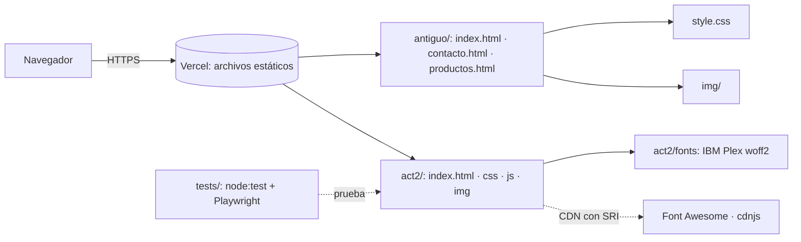

# Arquitectura de AgroSana

## Resumen
Sitio web estático de una planta agroquímica (AgroSana, Zihuatanejo, Guerrero) hecho con HTML,
CSS y JavaScript sin framework ni paso de build. Cada página es un archivo HTML independiente que
el navegador carga directamente; no hay servidor de aplicación, base de datos ni API. El código de
`antiguo/` es un prototipo previo (catálogo y contacto); las actividades del curso se entregan en
carpetas propias (`act2/`, …) con la estructura `index.html` + `css/` + `js/` + `img/`.

## Diagrama de componentes

## Módulos
| Módulo | Ruta | Responsabilidad | Depende de |
|---|---|---|---|
| Catálogo (legado) | `antiguo/index.html` | Encabezado de la marca y tarjetas de productos | `style.css`, `img/` |
| Contacto (legado) | `antiguo/contacto.html` | Menú, formulario de contacto sin envío, datos de contacto, pie | `css/estilos.css` (no existe), `js/app.js` (no existe) |
| Productos (legado) | `antiguo/productos.html` | Archivo vacío enlazado desde el menú de contacto | — |
| Estilos (legado) | `antiguo/style.css` | Dos hojas concatenadas: la de AgroSana (verde) y la de la práctica guiada (azul: `.hero`, `.modal`, `.servicios-grid`…) | — |
| Script (legado) | `antiguo/app.js` | Escribe en consola al pulsar cualquier botón; ninguna página lo carga | — |
| Imágenes | `antiguo/img/producto1-5.jpg` | Fotos de etiquetas: Frutime, Bio pH, HydroSpeed CaB-Max, Surfatek, Prozycar | — |
| Página única (act2) | `act2/index.html` | Encabezado fijo, panel de etiqueta con franja de categorías, Uso seguro, Productos con filtro y ventana de detalles, Nosotros, Contacto, pie con la advertencia (spec 003) | `css/estilos.css`, `js/app.js`, `img/`, `fonts/`, Font Awesome |
| Estilos (act2) | `act2/css/estilos.css` | Tokens de `docs/design/system.md` en `:root` y componentes del sistema; solo `var()` fuera de `:root` (P12) | `fonts/` |
| Comportamiento (act2) | `act2/js/app.js` | Menú desplegable, filtro por categoría, `<dialog>` de detalles y "Ver más precauciones"; sin sinks ni lectura de la URL | — |
| Fuentes (act2) | `act2/fonts/` | IBM Plex Sans 400/600/700 e IBM Plex Sans Condensed 700 (woff2) con `OFL.txt` (ADR 0007) | — |
| Imágenes (act2) | `act2/img/` | Fotos de producto con nombres descriptivos y `logo.svg` | — |
| Pruebas | `tests/` | Reglas estáticas U1–U7 (`node:test`) y casos E1–E20 de navegador (Playwright 1.56, 360/768/1440 px); servidor estático propio y CDN interceptado (ADR 0005) | `@playwright/test`, `@fortawesome/fontawesome-free` (solo desarrollo) |

## Flujo principal
El visitante abre `index.html`, el navegador descarga `style.css` y las imágenes y muestra el
catálogo. No hay navegación desde `index.html` hacia otras páginas. `contacto.html` se abre solo
por URL directa; su formulario no tiene `action` ni campos con `name`, así que al enviarlo la
página se recarga sin transmitir nada.

## Datos
Sin datos persistentes. El contenido (nombres de productos, contacto) está escrito en el HTML.

## Integraciones externas
Font Awesome 6.7.2 desde cdnjs con `integrity` y `crossorigin` (ADR 0004), único recurso externo de `act2/`. Las fuentes IBM Plex se sirven desde el propio sitio (ADR 0007). Vercel sirve los archivos (decisión del usuario, 2026-10-08).

## Frontend
- Componentes y organización: páginas HTML con clases CSS (`.card`, `.productos`, `.contacto`, `.formulario`).
- Estado: ninguno.
- Routing: archivos HTML y anclas internas.
- Design tokens / sistema de diseño: `act2/` usa el sistema aprobado [docs/design/system.md](design/system.md) (opción A · La etiqueta + IBM Plex), copiado en `:root` de `act2/css/estilos.css` y verificado por U6/U7 (constitución P12). `antiguo/` sigue con colores y tamaños literales en `style.css`.
- Accesibilidad: objetivo WCAG 2.1 AA para código nuevo (constitución P7).

## Despliegue
Vercel importa el repositorio de GitHub y publica la raíz como sitio estático; cada push a `main`
genera producción y cada rama o PR una Preview. Detalle en [deployment.md](deployment.md).

## Evidencia (solo si status=inferred)
| Afirmación | Archivos | Confianza |
|---|---|---|
| Sitio estático sin build ni manifiesto | raíz sin `package.json` ni configuración | alta |
| `contacto.html` enlaza hojas y scripts inexistentes | `contacto.html` líneas 8 y 70 | alta |
| `index.html` referencia `producto6.jpg` y `producto7.jpg`, que no existen | `index.html`, `img/` | alta |
| `style.css` contiene dos hojas concatenadas | `style.css` (dos bloques `* { … }` y `body { … }`) | alta |
| `app.js` no se carga desde ninguna página | `index.html`, `contacto.html` | alta |

## Deuda técnica y riesgos observados
- Páginas legado con recursos rotos (hoja `css/estilos.css`, `js/app.js`, `producto6/7.jpg`) y `productos.html` vacío.
- Imágenes con `alt=""` aunque son de contenido.
- Estilos sin tokens y con reglas de la práctica guiada que el HTML no usa.
