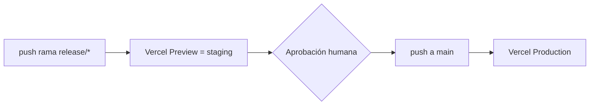

# Despliegue de AgroSana

> Regla innegociable: ningún deploy a producción sin aprobación humana explícita.

Hoy el proyecto no tiene despliegue (no había repositorio ni servidor). La estrategia siguiente es
la acordada con el usuario (decisión del usuario, 2026-10-08): GitHub + Vercel.

## Entornos
| Entorno | URL | Rama / disparador | Aprobación | Datos |
|---|---|---|---|---|
| dev | `http://localhost:8080/act2/` | local: `python -m http.server 8080` en la raíz | ninguna | contenido de ejemplo |
| staging | Preview de Vercel (`https://<proyecto>-git-<rama>-<cuenta>.vercel.app/act2/`) | push de una rama distinta de `main` (p. ej. `release/vX.Y.Z`) | ninguna | mismo contenido |
| prod | `https://agro-sana.vercel.app/act2/` | push o merge a `main` | **humana** (el usuario hace el push) | mismo contenido |

## Plataforma e infraestructura
Vercel, proyecto importado desde el repositorio de GitHub (`Luisander2651/DenysAct2`, proyecto `agro-sana`). `vercel.json` en la raíz solo activa `"trailingSlash": true` (T037), para que `/act2` redirija a `/act2/` y las rutas relativas carguen. Configuración: *Framework Preset*
**Other**, sin *Build Command*, *Output Directory* vacío (raíz). Sin IaC ni variables de entorno.
La raíz no tiene `package.json`; `tests/package.json` no afecta el despliegue.

## Pipeline

No hay CI propio: los tests (`npm test --prefix tests`) se ejecutan en local o en la sesión de `/implement`/`/review` antes del push.

## Cómo desplegar
```bash
# staging (Preview)
git push origin release/vX.Y.Z           # Vercel crea la Preview y muestra su URL
# producción (solo tras la aprobación de /release)
git checkout main && git merge --ff-only release/vX.Y.Z && git push origin main --follow-tags
```
Primera vez: crear el repo en GitHub, `git remote add origin <url>`, `git push -u origin main`,
y en Vercel → *Add New Project* → importar el repo con la configuración de arriba.

## Migraciones de base de datos
- No aplica: el sitio no tiene base de datos.

## Rollback
1. Vercel → proyecto → *Deployments* → elegir el despliegue de producción anterior → *Instant Rollback*.
2. En el repo: `git revert <commit>` (o los commits de la versión) y `git push origin main` para que el siguiente despliegue no reintroduzca el cambio.
- Tiempo estimado: < 2 minutos para el paso 1.
- Si hubo migración: no aplica.

## Variables de entorno
| Nombre | dev | staging | prod | Dónde se configura |
|---|---|---|---|---|
| — | — | — | — | Sin variables |

(Solo nombres. Nunca valores.)

## Verificación post-deploy
- Health check: `https://agro-sana.vercel.app/act2` redirige (308) a `/act2/`, que responde 200 por HTTPS.
- Smoke tests: comando único `BASE_URL=<url> npm run smoke --prefix tests` (E1 `@smoke` en 1440 px contra la URL, con el CDN real de Font Awesome; spec 003, A6).
- Logs: panel de Vercel → *Logs* (solo peticiones). Ver [observability.md](observability.md).
- Trazabilidad: no aplica (sitio estático sin `request_id` propio).

## Riesgos conocidos
### RD1 · Media — Vercel puede intentar construir si aparece un `package.json` en la raíz
Un `package.json` en la raíz haría que Vercel ejecute instalación y build, y el despliegue podría fallar o publicar otra carpeta.
Correcciones:
- RD1.a Mantener las herramientas solo en `tests/` (test de estructura que falla si existe `package.json` en la raíz) — estado: en curso (spec 003)
